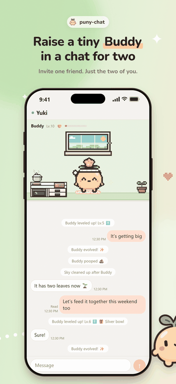
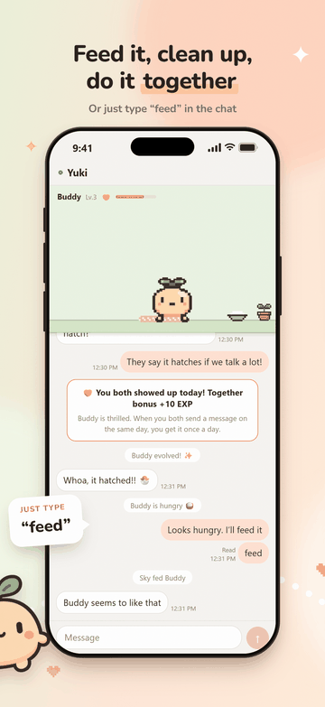
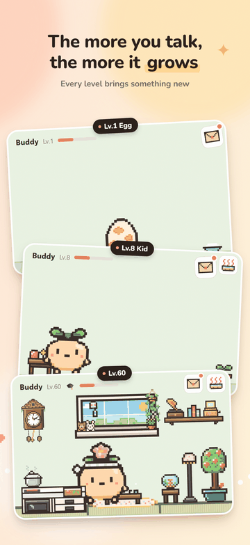
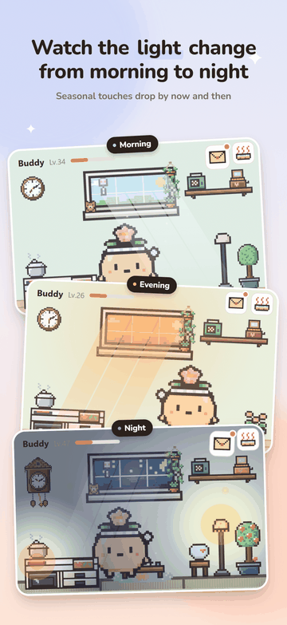
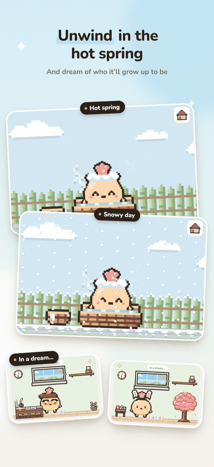
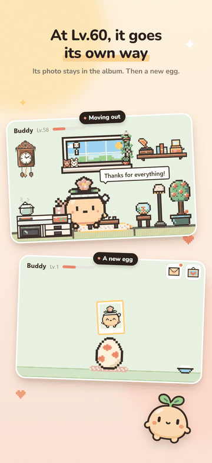
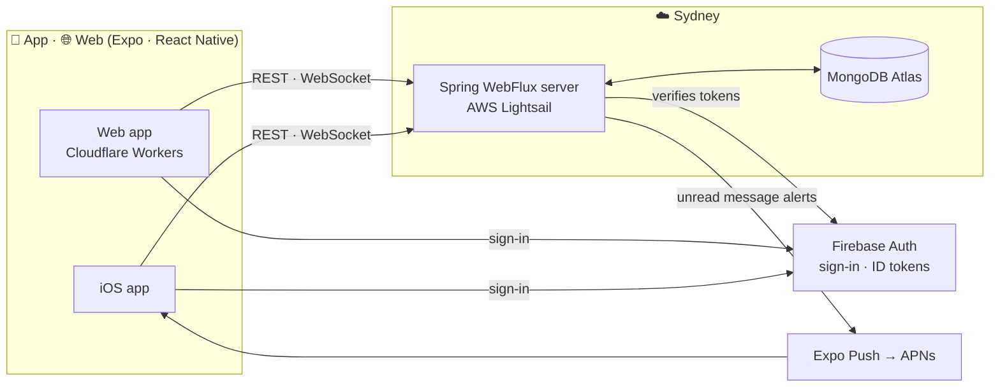

<div align="center">

# 🥚 Puny Chat

**Chat with someone you like, and raise a tiny buddy together.**

**[👀 Take a look, no sign-up](https://puny-chat.com/demo)** · [Start on the web](https://puny-chat.com) · [Spec (Korean)](docs/PROJECT.md)

<br>

<table>
  <tr>
    <td align="center"></td>
    <td align="center"></td>
    <td align="center"></td>
  </tr>
  <tr>
    <td align="center"></td>
    <td align="center"></td>
    <td align="center"></td>
  </tr>
</table>

</div>

<br>

## What it is

A **messenger for exactly two people**, with one small pixel creature living above the chat.

```text
18:02   Buddy pooped 💩

Yuki    lol buddy pooped
Henry   lol you clean it
```

The buddy gets hungry and poops, and it grows the more you two talk. It picks up a job, its room fills up level by level, and at level 60 it goes its own way. It never dies, and there are no missions or ads.

> **Chat first. Buddy makes it fun.** The chat is the main character; the buddy is a small friend on the side.

- No sign-up: start as a guest in a few seconds, link Apple or Google later
- iPhone first, the same app on the web · English, 日本語, 한국어, 繁體中文

<br>

## How it's built



| Area | Built with |
| --- | --- |
| App | Expo (React Native), TypeScript, Expo Router — iOS and web from one codebase |
| Server | Java 25, Spring Boot 4, WebFlux, WebSocket |
| Data | MongoDB Atlas |
| Auth · Push | Firebase Authentication, Expo push, Web Push |
| Infra | AWS Lightsail, Cloudflare Workers, Terraform, GitHub Actions, EAS |

Built **small**, to fit a small service:

- **Messages arrive exactly once.** After a dropped connection the app fills in what it missed and resends what it couldn't send, without duplicates.
- **No broker, no scheduler.** One server holds every live connection, and the buddy's hunger and 💩 are computed when looked at.
- **No transactions.** Concurrency (two people feeding at once, racing invites) is handled with conditional updates and unique indexes, and shown in tests.

The decisions and the reasons behind them are in the [spec](docs/PROJECT.md) (Korean).

<br>

## Running locally

```bash
# Server (MongoDB starts with it in Docker) → http://localhost:8080
cd server && ./gradlew bootRun

# App (web) → http://localhost:8081
cd app && cp .env.example .env.local   # fill in the Firebase web config
pnpm install && pnpm web
```

On an iPhone, open it with a development build. The commands are collected in [CLAUDE.md](CLAUDE.md) (Korean).

## Status

Live on the web at [puny-chat.com](https://puny-chat.com). The iOS app (1.0) is in App Store review.

## License

[MIT](LICENSE). Use the code freely; keep the copyright notice and license text with it.
