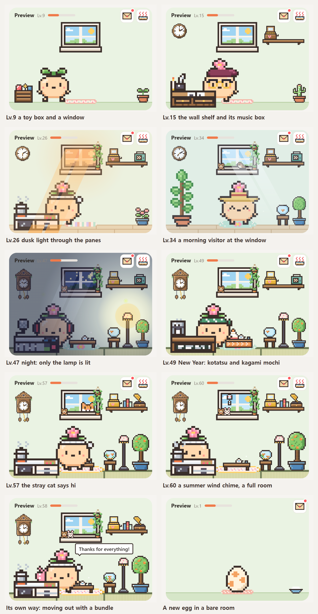
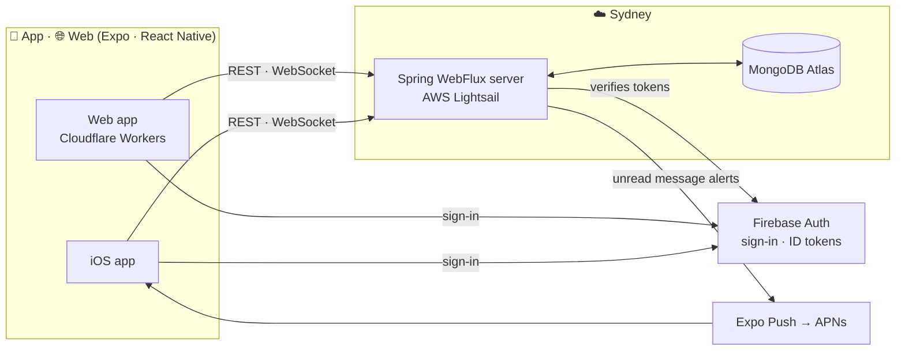

<div align="center">

# 🥚 puny-chat

**English** · [한국어](README-kr.md)

**Chat with someone you like, and raise a tiny buddy together.**

**[👀 Take a look, no sign-up](https://puny-chat.com/demo)** · [Start on the web](https://puny-chat.com) · [Product and server spec](docs/PROJECT.md)

<br>


<sub>The tour: from egg to adult in 55 seconds</sub>

</div>

<br>

## What it is

puny-chat is a **messenger for exactly two people**. And between those two lives one small creature.

```text
18:02   Buddy pooped 💩

Yuki    lol buddy pooped
Henry   lol you clean it
Yuki    nope lol
```

In the middle of an ordinary "what did you eat today?" conversation, the Buddy now and then makes something happen.
It gets hungry, it poops, and the more the two of you talk, the more it grows. No AI throwing conversation starters
at you, no daily missions. Just **having something to raise together** makes the chat a little more fun.

> **Chat first. Buddy makes it fun.** The chat is the main character; the Buddy is a small friend on the side.

<br>

<div align="center">
<table>
  <tr>
    <td align="center"><br><sub><b>Start on your own</b><br>The egg hatches, straight into the chat</sub></td>
    <td align="center"><br><sub><b>Invite one friend</b><br>4-character code, single use</sub></td>
    <td align="center"><br><sub><b>Chat and care together</b><br>Typing · read · online</sub></td>
    <td align="center"><br><sub><b>Look after the Buddy</b><br>Feed · clean up</sub></td>
  </tr>
</table>
</div>

<br>

## What you can do

**💬 Chat**
- 1:1 real-time messages. After a dropped connection, missed messages fill in, and unsent ones are delivered **exactly once**
- Online status, typing, read receipts
- New messages arrive as push notifications while the app is closed (iOS, and the web added to the home screen)

**🐣 Buddy**
- A pixel Buddy wanders a small stage above the chat. Feed it and it munches; a message from your partner makes it hop
- It grows from egg → baby → kid → adult. The more you talk and care for it, the faster
- Over time it gets hungry and poops. Tap the bowl or the 💩, or just send "food" in the chat, and the chat notes who did it
- Left alone it dances and sings. Once a kid, it talks too: "Long time no see!", "Have you eaten?"
- **It never dies.** Forget it for a few days and it's fine; a little care and it's back on its feet
- A little after it grows up (Lv.12), it takes a job from how you two raised it (chef, gardener, radio DJ, writer, barista), each with its own look and spot on the stage. You can change it once each at level 20, 30, 40 and 50, and any time from 60. It dresses up for the season (bunny ears in spring, antlers at Christmas) and now and then a butterfly lands on it or a shooting star crosses the sky
- Every level the room gets something: a toy box, a window whose sky follows your clock, a wall shelf with a music box and a radio, plush friends on the sill, a goldfish bowl, a low table that turns into a kotatsu in winter, new rugs and floors, a tree that bears fruit, and guests at the window (a snail, a sparrow, a stray cat, an owl at night, a red dragonfly in autumn). From level 20 it can go its own way; keep it to level 60 and the room keeps growing (below)
- The same room in the light of the hour: a fresh morning, sunset light slanting through the panes, a night lit only by the lamp. At level 60, light comes down from the sky and a letter from the developer arrives in the stage's mailbox
- **A hot spring** to send it to, and **a dream** of what it will become before the first egg (below)

**🤝 For two**
- When you both send a message on the same day, a **together bonus** 🤝 once a day. It grows better when you two talk
- No sign-up. **Get started** first plays a 55-second room where the egg grows into an adult; then pick your name and the egg's,
  and that's it. Link a Google account later and everything carries over
- Got a friend's code? **Start with an invite code**: the code and your name, and you're in their room
- Start on your own and invite one friend any time; the Buddy you've been raising stays
- At most two people per room. A space just for you two

**🌏 Anywhere**
- Built for iPhone first, and the same app runs on the web
- 한국어 · 日本語 · English, light and dark mode

<br>

### From an egg to its own way

Nothing is pushed out of the room: a spot not used yet fills, or a thing already there gets finer. When the buddy goes its own way it packs its things in a bundle, waves goodbye and walks off, and a new egg arrives in a bare room. Its photo goes into the memory album, opened from the button beside the hot spring.

<div align="center">

</div>

<br>

### A soak and a dream

Tap ♨ in the stage's corner and the buddy goes for a soak in an open-air hot spring: a towel on its head, steam, clouds drifting by, and snow in winter. It stays until you take it home (or ten minutes pass); whatever happens in the room meanwhile shows in the chat, and an evolution plays once it's back. The scene changes with a black circle that closes on the buddy, holds for a beat and opens again.

<div align="center">
<table>
  <tr>
    <td align="center"><br><sub>The circle closes on the buddy</sub></td>
    <td align="center"><br><sub>In the hot spring</sub></td>
    <td align="center"><br><sub>In winter it snows</sub></td>
  </tr>
</table>
</div>

The first time a room shows its egg, it opens instead on a dream of what the egg may grow into: four quick cuts, about five seconds, each a different job and a different day. Then the circle closes, and it wakes up as an egg.

<div align="center">
<table>
  <tr>
    <td align="center"><br><sub>A barista</sub></td>
    <td align="center"><br><sub>A writer in love</sub></td>
    <td align="center"><br><sub>Christmas</sub></td>
    <td align="center"><br><sub>The hot spring</sub></td>
  </tr>
</table>
</div>

<br>

## Architecture



| Area | Built with |
| --- | --- |
| App | Expo (React Native), TypeScript, Expo Router — iOS and web from one codebase |
| Server | Java 25, Spring Boot 4, WebFlux (reactive), WebSocket |
| Data | MongoDB Atlas; concurrency through conditional updates and unique indexes, no transactions |
| Auth · Push | Firebase Authentication, Expo push service, Web Push |
| Infra | AWS Lightsail · MongoDB Atlas · Cloudflare Workers, Terraform (state in R2), GitHub Actions |

Built **small**, to fit a small service. One server holds every real-time connection, so there is no Redis or other
broker in between, and the Buddy's hunger and 💩 are **computed when looked at**, with no scheduler. The decisions
and the reasons behind them are in the [spec](docs/PROJECT.md) (Korean).

<br>

## Repository layout

```text
app/      Expo app (iOS · web)
server/   Spring WebFlux server
infra/    Terraform (Atlas · Cloudflare)
docs/     Product and server design docs (Korean)
```

## Running locally

```bash
# Server (MongoDB starts with it in Docker) → http://localhost:8080
cd server && ./gradlew bootRun

# App (web) → http://localhost:8081
cd app && cp .env.example .env.local   # fill in the Firebase web config
pnpm install && pnpm web
```

On an iPhone, open it with a development build. The commands are collected in [CLAUDE.md](CLAUDE.md) (Korean).

<br>

## Where it stands

- [x] Start right away as a guest, link an account (Google on the web), create · invite · leave a room
- [x] Real-time chat (reconnecting, exactly-once sending, typing · read · online)
- [x] Buddy care and growth, the together bonus
- [x] Deployment (server on AWS Lightsail · web on Cloudflare Workers · DB on Atlas)
- [x] Buddy pixel character and animations (eating · 💩 · evolving · reacting to messages)
- [x] Web Push (the web added to the home screen)
- [x] Jobs, seasonal looks, small happenings, the hot spring and the dream before the first egg
- [x] The room's things every level, seasonal things, the memory album, the mailbox, the light of the hour
- [ ] iPhone build checked on a device (Sign in with Apple and push are written, not yet tried on an iPhone)
- [ ] App Store release

## License

[MIT](LICENSE). Use the code freely; keep the copyright notice and license text with it.
